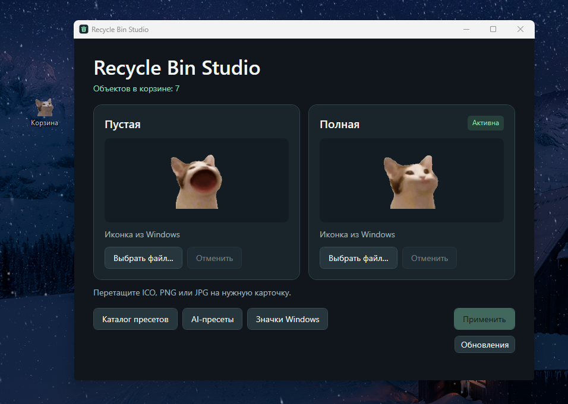

<p align="center">
  
</p>

<h1 align="center">Recycle Bin Studio</h1>

<p align="center">Редактор иконок пустой и полной корзины Windows</p>

<p align="center">
  
  <a href="https://github.com/Kaev-1n/recycle-bin-studio/releases/latest"></a>
  
</p>

<p align="center">
  
  <br>
  <sub>Главный экран версии в разработке</sub>
</p>

## Как пользоваться

1. Скачайте [релиз для x64 или ARM64](https://github.com/Kaev-1n/recycle-bin-studio/releases/latest), распакуйте ZIP и запустите `RecycleBinStudio.exe`.
2. Перетащите ICO, PNG или JPG на нужную карточку. Кнопка «Загрузить Pop Cat» подставит готовую пару.
3. Проверьте превью и нажмите «Применить». Кнопка «Значки Windows» вернёт стандартные иконки.

Приложение обновляет счётчик корзины и показывает активное состояние. Импорт сохраняет пропорции и собирает ICO в размерах от 16 до 256 пикселей.

## Сборка

```powershell
dotnet run --project src/RecycleBinStudio
```

C# · WPF · .NET 10 · [MIT](LICENSE) · [Источник Pop Cat](https://github.com/sdushantha/recycle-bin-themes/tree/main/themes/pop-cat)
